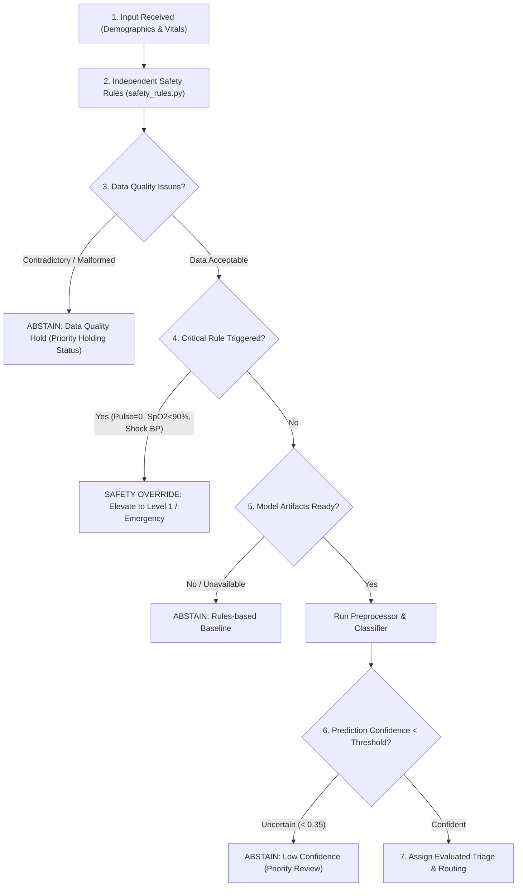

# MediTriage AI — Machine Learning Pipeline & Assessment Decision Engine

## Overview

The MediTriage AI machine learning system provides **clinical decision support** for high-volume outpatient departments (OPDs) in resource-constrained public hospitals. It combines:
1. An **auditable, reproducible ML training pipeline** (XGBoost with Scikit-learn fallback).
2. A **deterministic clinical safety rules engine** (`app/safety_rules.py`) that strictly overrides model suggestions in the presence of severe physiological red flags.
3. An **explicit abstention framework** that escalates uncertain cases or data-quality holds to human clinician review without ever placing patients at the back of the queue.

---

## 1. Dataset Format & Schema Contract

If an official hospital dataset is present, it must be provided as a **CSV**, **JSON**, or **Parquet** file. If absent, the pipeline automatically falls back to generating reproducible synthetic fixtures (`app/ml/synthetic_data.py`).

### Permitted Feature Columns (Input Space)

| Column | Type | Description | Handling |
| :--- | :--- | :--- | :--- |
| `age` | Integer [0, 130] | Patient age in years (0 for infants) | Median imputed, scaled |
| `gender` | Categorical | `Male`, `Female`, `Other`, `Unspecified` | Imputed + One-Hot Encoded |
| `chief_complaint` | Text | Verbatim complaint in patient's words (English / Telugu) | TF-IDF (1-2 n-grams) |
| `known_conditions_text` | Text | Comma-separated pre-existing chronic conditions | Multi-label CountVectorizer |
| `systolic_bp` | Integer [40, 300] | Systolic blood pressure in mmHg (optional) | Median imputed + Missing Indicator |
| `diastolic_bp` | Integer [20, 200] | Diastolic blood pressure in mmHg (optional) | Median imputed + Missing Indicator |
| `pulse_bpm` | Integer [0, 300] | Heart rate in bpm (0 indicates pulselessness) | Median imputed + Missing Indicator |
| `temperature_f` | Float [85.0, 115.0] | Standardized body temperature in °F (optional) | Median imputed + Missing Indicator |
| `temperature_unit` | Categorical | `F` or `C` | One-Hot Encoded |
| `spo2` | Float [30.0, 100.0] | Oxygen saturation % (optional) | Median imputed + Missing Indicator |
| `respiratory_rate` | Integer [5, 80] | Breaths per minute (optional) | Median imputed + Missing Indicator |
| `avpu` | Categorical | `ALERT`, `VERBAL`, `PAIN`, `UNRESPONSIVE` | One-Hot Encoded |

> [!IMPORTANT]
> **Missing Value Integrity**: Missing vitals are preserved and explicitly encoded using `SimpleImputer(add_indicator=True)`. Missing vitals are **never** silently converted into default normal numbers (e.g. SpO2 98% or BP 120/80).

### Forbidden Columns (Data Leakage & Post-Outcome Fields)

The following columns are **strictly forbidden** from the feature matrix and are filtered out by `sanitize_features()`:
- **Identifiers**: `patient_id`, `id`, `token_number`, `patient_name`, `contact_phone`, `opd_registration_number`.
- **Post-Outcome Data**: `admission_status`, `discharged_at`, `length_of_stay`, `icu_transfer`, `final_diagnosis`, `doctor_room`, `billing_amount`, `prescription`.
- **Label-derived fields**: `triage_category`, `triage_level`, `department`, `is_emergency`.

### Target Variables

1. `triage_level`: Multi-class integer (1 to 5 for standard CTAS/ESI triage, or 1 to 3 for Emergency/Priority/Routine).
2. `department`: Specialty routing (e.g. `General Medicine`, `Cardiology`, `Pulmonology`, `Emergency / Casualty`, `Orthopedics`, `Pediatrics`, `Obstetrics & Gynecology`, `Dermatology`).
3. `is_emergency`: Binary flag (0 or 1) when specified separately in the dataset.

---

## 2. Training the Model

Run the pipeline from the `backend/` directory:

```bash
# 1. Train using default settings (uses synthetic fixture if official dataset is absent)
python -m app.ml.train

# 2. Train on an official CSV dataset
python -m app.ml.train --data /path/to/official_opd_data.csv --output app/ml/artifacts/v1

# 3. Train using Scikit-learn fallback (HistGradientBoosting) without XGBoost
python -m app.ml.train --no-xgb --seed 42 --samples 300
```

### Command Options

- `--data <path>`: Path to CSV, Parquet, or JSON dataset.
- `--output <dir>`: Directory where versioned artifacts are saved (defaults to `app/ml/artifacts/v1`).
- `--no-xgb`: Disables XGBoost and uses `HistGradientBoostingClassifier` as the deterministic baseline.
- `--seed <int>`: Random seed for stratified train/test split and training reproducibility (default: `42`).
- `--samples <int>`: Number of samples if generating synthetic fixture (default: `250`).

---

## 3. Evaluation Metrics & Clinical Safety Protocols

Standard machine-learning accuracy alone is insufficient for clinical triage. The evaluation module (`app/ml/evaluate.py`) computes:

1. **Emergency Sensitivity / Recall**: $\frac{\text{True Emergencies Predicted as Emergency}}{\text{Total Actual Emergencies}}$.
2. **Emergency False Negatives**: Number of life-threatening Level 1 cases incorrectly categorized as low-urgency. In clinical safety engineering, false negatives must be minimized towards zero.
3. **Macro & Weighted Precision, Recall, F1**.
4. **Per-class confusion matrices**.
5. **Department classification macro and weighted F1**.

---

## 4. Assessment Integration & Decision Flow (`POST /api/assessments`)

Endpoint: `POST /api/assessments`

### The 7-Step Decision Flow



### Safety Principles

- **Critical Rules Always Override**: A critical clinical alert (e.g. pulselessness, severe hypoxia, systolic BP < 90) strictly overrides any machine-learning suggestion to Level 1 / Emergency.
- **Abstention Never Drops Urgency**: When the system abstains due to uncertainty, data holds, or missing models, the patient is assigned **Priority Holding** status with clinician review required—never routine or end-of-queue.
- **Explainability**: Outputs include detected red flags, rule explanations, missing measurement warnings, and abstention status.
