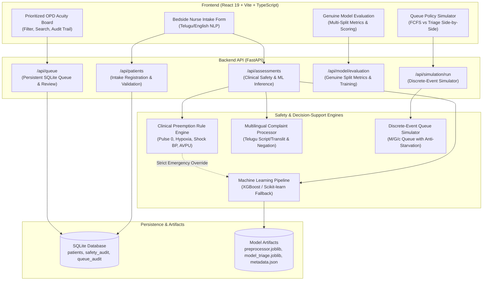

# MediTriage AI — Technical & Clinical Architecture

## 1. System Overview

**MediTriage AI** is a clinical decision-support and queue stratification prototype built for high-volume outpatient departments (OPDs) in public and district hospitals. 

The core challenge addressed is **queue misprioritization**: when patient influx reaches hundreds of arrivals per hour, a naïve First-Come-First-Served (FCFS) queuing mechanism inevitably places critically unstable patients behind routine chronic care cases.

---

## 2. Multi-Tier System Architecture

---

## 3. Core Architectural Components

### 3.1 Deterministic Clinical Safety Engine (`app/safety_rules.py`)
- Adapts the **Emergency Severity Index (ESI)** and **Manchester Triage System (MTS)**.
- **Critical Safety Override Rule**: If an acute physiological red flag is detected (e.g., SpO2 < 90%, Pulse = 0 bpm, SBP < 90 mmHg with acute chest pain, AVPU $\ne$ Alert), the rule engine strictly overrides lower-urgency ML predictions and assigns Level 1 (Emergency).
- **Data Quality & Abstention**: Evaluates vital sign sanity (e.g. SBP $\le$ DBP is rejected; pulseless alert patients trigger contradiction holds).
- Missing vital signs are marked `MISSING` and are **never** filled with default normal values.

### 3.2 Multilingual Complaint NLP Component (`app/nlp/`)
- **Verbatim Preservation**: Preserves the original patient narrative without silent alteration.
- **Language Identification**: Separates English, Telugu script (`గుండె నొప్పి`), and Latin-transliterated Telugu (`gunde noppi`).
- **Contextual Negation Detection**: Accurately distinguishes positive symptoms from negated phrases (e.g., *"patient denies chest pain"* or *"aayasam ledu"*).
- **Red Flag Extraction**: Flags high-risk symptom concepts (acute chest pain, respiratory distress, convulsions, stridor) independently for clinician review.

### 3.3 Machine Learning Pipeline (`app/ml/`)
- **Strict Anti-Leakage 3-Way Split**: Training data is divided into **Training (60%)**, **Validation (20%)**, and **Holdout Test (20%)** splits. Preprocessors and scalers are fitted **strictly on the training split only**.
- **Model Architecture**: Multi-class gradient boosted trees (XGBoost with HistGradientBoostingClassifier fallback).
- **Safety Fallback**: If model artifacts are missing or unreadable, the system falls back to `ABSTAINED_MODEL_UNAVAILABLE` and routes the patient through deterministic safety rules without throwing exceptions.
- **Clinical Evaluation Scoring**: Official scoring places 50% weight on Emergency Recall / Sensitivity and penalizes emergency false negatives.

### 3.4 Persistent Queue & Nurse Review Workflow (`app/models.py` & `app/api/routes.py`)
- SQLite-backed patient queue tracking arrival time, triage acuity, assigned department, and review status.
- **Escalation Prominence**: Critical Level 1 and deteriorating cases are surfaced prominently at the top of the queue.
- **Human-Review Retention**: Cases lacking model scores or placed on data quality hold cannot drop to the back of the queue.
- **Audit Logging**: Every status transition, nurse review, bedside deterioration report, and reassessment is immutably logged to `QueueAuditModel`.

### 3.5 Discrete-Event Queue Simulator (`app/simulation/`)
- Parameterized multi-server ($M/G/c$) queueing model comparing First-Come-First-Served (FCFS) against Triage-Assisted scheduling.
- **Preemption Rule**: Emergency Level 1 patients take immediate priority over non-urgent arrivals.
- **Anti-Starvation Guard**: Monitored wait times trigger dynamic reassessment priority bumps for routine patients waiting past the starvation threshold (e.g., 90 minutes).

---

## 4. Privacy, Security & Compliance Controls
1. **Logging Hygiene**: Patient names, telephone numbers, and clinical complaints are never output to server logs or console output.
2. **Zero Hardcoded Secrets**: All backend and frontend settings are loaded via environment variables (`.env`) with secure localhost defaults.
3. **Database Isolation**: SQLite database uses foreign-key constraints and UTC timestamps.

---

## 5. Investigational Notice
MediTriage AI is an experimental decision-support prototype. It is not approved by CDSCO, US-FDA, or CE as a certified medical device and is not connected to production hospital infrastructure. Bedside healthcare professional evaluation remains supreme.
